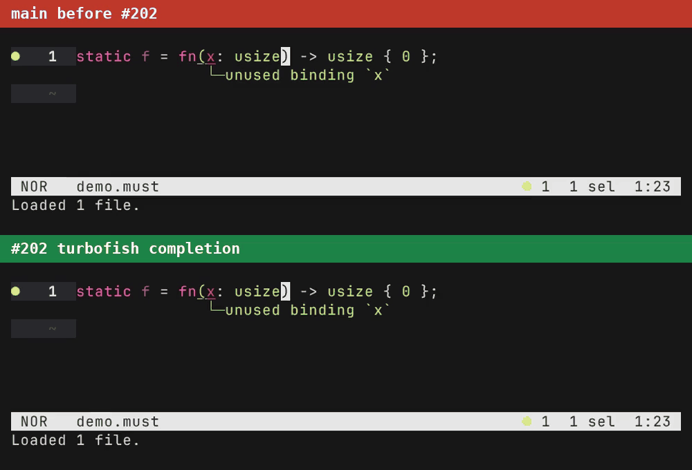

# Editor demos

Before/after recordings of editor behaviour, referenced from PR descriptions.
Orphan branch, never merged into main. Link GIFs from PR descriptions by commit sha:
`https://github.com/halvko/must/blob/<sha>/<dir>/<file>.gif?raw=true`. Recipe: editor-demos in the project files.

## #202 turbofish completion

